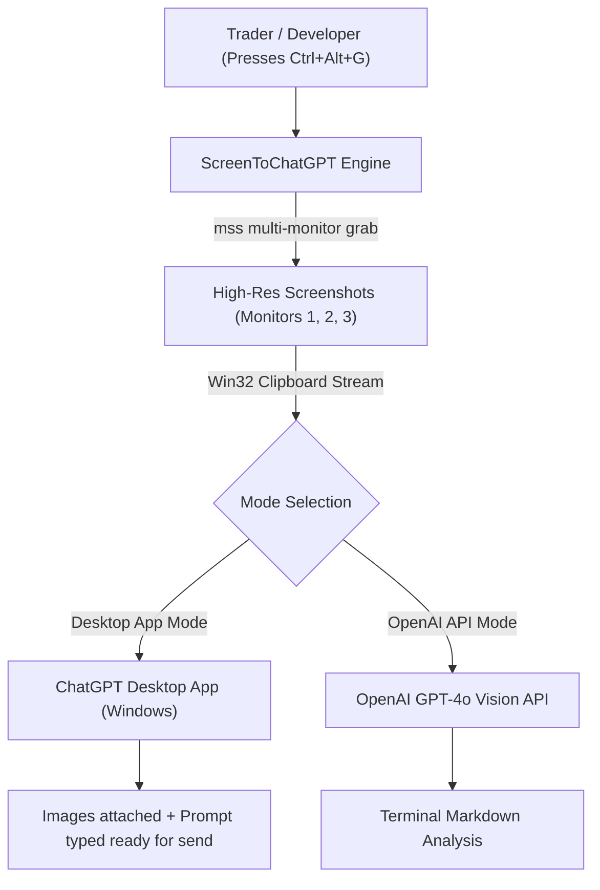

# 📸 ScreenToChatGPT (Desktop Screen Capture & Visual AI Assistant)

[](https://github.com/damsarachethiyaa-dev/Screen-Capture)
[](https://www.python.org/)
[](https://openai.com)
[](https://github.com/damsarachethiyaa-dev/Screen-Capture)
[](https://github.com/damsarachethiyaa-dev/Screen-Capture)

> **Created by Chethiya Rathnasekara**  
> *Instant multi-monitor screenshot capture tool with live monitor preview, customizable prompt presets, and automated injection into the ChatGPT desktop app or direct OpenAI GPT-4o analysis.*

---

## 📑 Table of Contents

1. [Key Features](#-key-features)
2. [Quick Start (Pre-Built Executable)](#-quick-start-pre-built-executable)
3. [Running from Source](#-running-from-source)
4. [How It Works](#-how-it-works)
5. [Global Hotkeys & Prompt Presets](#-global-hotkeys--prompt-presets)
6. [Building the Standalone .EXE](#-building-the-standalone-exe)
7. [Project Structure](#-project-structure)
8. [Author](#-author)

---

## ✨ Key Features

- 🖥️ **Full Multi-Monitor Support:** Automatically detects every connected monitor and captures high-resolution screenshots without cursor latency.
- ⚡ **Global Hotkey (`Ctrl + Alt + G`):** Trigger instant screen capture and AI injection from any application, game, or trading chart in the background.
- 🎨 **Dark Modern GUI (`capture_gui.py`):** Live thumbnails of every connected display, monitor toggles (select which screens to capture), and custom prompt editors.
- 🤖 **Automated ChatGPT Desktop Injection:** Brings the official Windows ChatGPT desktop application to the foreground, attaches all screenshots in sequence, pastes your prompt, and prepares it for instant review or automatic submission.
- 🌐 **Direct OpenAI API Mode (`screen_to_chatgpt.py`):** Headless CLI mode that encodes screenshots into high-detail base64 images and streams GPT-4o responses directly to your terminal.
- 🎯 **Tailored Trading & Dev Presets:** Pre-configured prompts for reading order flow (ATAS / TradingView charts), key support/resistance levels, delta divergences, and code debugging.
- 📦 **Zero-Install Standalone EXE:** Comes pre-packaged with PyInstaller (`dist/ScreenToChatGPT.exe`) — run it on any Windows computer with zero setup!

---

## 🚀 Quick Start (Pre-Built Executable)

No Python installation required!

1. Navigate to the `dist/` directory:
   ```text
   dist/ScreenToChatGPT.exe
   ```
2. Double-click **`ScreenToChatGPT.exe`** to launch the GUI.
3. Keep the **ChatGPT desktop app** open in the background.
4. Press **`Ctrl + Alt + G`** anytime to capture your screens and inject them directly into ChatGPT!

---

## 🛠️ Running from Source

### Prerequisites
- **Python:** 3.10 or higher
- **Windows:** 10 / 11

### 1. Install Dependencies
```bash
pip install -r requirements.txt
pip install pyautogui pygetwindow pywin32 pillow
```

### 2. Launch the Desktop GUI
```bash
python capture_gui.py
```

### 3. Or Run the CLI API Mode
To query OpenAI GPT-4o directly without opening the ChatGPT desktop app:
```powershell
# Set your API key
$env:OPENAI_API_KEY = "sk-..."

# Run direct capture & visual analysis
python screen_to_chatgpt.py "Analyze these trading charts and identify any potential reversal patterns."
```

---

## 💡 How It Works



---

## ⌨️ Global Hotkeys & Prompt Presets

### Default Hotkey:
- **`Ctrl + Alt + G`**: Captures enabled monitors, focuses the ChatGPT desktop application, attaches images, and pastes the selected prompt preset.

### Built-in Presets:
1. **Order Flow Read:** Deep inspection of absorption, exhaustion, delta divergences, and liquidity sweeps.
2. **Key Levels:** Locates support/resistance, high-volume nodes, and order blocks.
3. **General Screen Inspection:** Comprehensive overview identifying actionable items or bugs on screen.
4. **Code & Debug Review:** Identifies exceptions, stack traces, and formatting issues in active IDE windows.

All presets are fully editable in the GUI and persist automatically to `screens_to_chatgpt_config.json`.

---

## 📦 Building the Standalone .EXE

To rebuild the standalone executable using PyInstaller:

```bash
pip install pyinstaller
pyinstaller ScreenToChatGPT.spec
```

The compiled binary will be placed in `dist/ScreenToChatGPT.exe` with bundled icons and manifest permissions.

---

## 📂 Project Structure

```text
Screen-Capture/
├── capture_gui.py                 # Full dark-theme Tkinter GUI with monitor previews & hotkeys
├── screen_to_chatgpt_desktop.py   # Windows automation script (clipboard & window management)
├── screen_to_chatgpt.py           # Headless OpenAI GPT-4o vision CLI utility
├── create_icon.py                 # Icon generator script
├── app.ico / app_preview.png      # Application graphics and branding assets
├── requirements.txt               # Python package dependencies
├── ScreenToChatGPT.spec           # PyInstaller build specification
├── dist/
│   ├── ScreenToChatGPT.exe        # Compiled ready-to-run Windows executable (~21 MB)
│   └── screens_to_chatgpt_config.json # User settings and saved prompt presets
└── README.md                      # Complete project documentation
```

---

## 👤 Author

- **Developer:** [Chethiya Rathnasekara](https://github.com/damsarachethiyaa-dev)
- **Repository:** [https://github.com/damsarachethiyaa-dev/Screen-Capture](https://github.com/damsarachethiyaa-dev/Screen-Capture)
